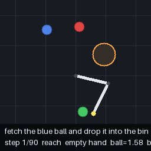
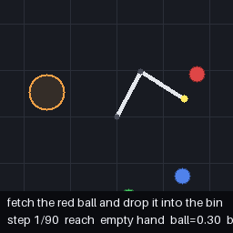
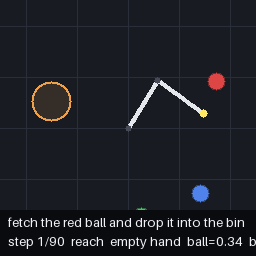

# PocketVLA：GRPO 奖励设计与抓取失败分析

简体中文 | [English](docs/README_EN.md)

基于 [penpenzh/pocketvla](https://github.com/penpenzh/pocketvla) 的个人复现与实验项目，由 [os-till-go](https://github.com/os-till-go) 维护。沿用上游的 3.02M 参数 VLA、二维机械臂仿真器和训练流程，重点研究：**模型为什么抓不到球？增加抓取中间奖励能否改善闭环成功率？**

## 我的工作

- **失败诊断**：比较同一批场景上的成功/失败变化，以及接近方向反转、抓取窗口重入和夹爪指令变化，区分行为观察与机制解释。
- **奖励设计**：在 GRPO 中增加可配置的 `inwin_bonus`，对空手、处于目标球抓取窗口且发出闭爪指令的回合额外奖励一次。
- **受控实验**：提供 G1（原奖励）与 G3（额外奖励 0.3）的 100 轮配置，训练预算一致。
- **结果审计**：发布逐场景结果、来源报告哈希、配对 McNemar 检验和 bootstrap 差值区间；保留未显著改善的结果。

上游提供模型、仿真、专家数据生成、SFT、GRPO 基础算法及 ID/OOD 评测。本 fork 的扩展是奖励项、实验配置、诊断工具和下列实验记录。原项目说明与下载保留在 [中文归档](docs/UPSTREAM_README_ZH.md) / [英文归档](docs/UPSTREAM_README_EN.md)；许可证保留 [Apache-2.0](LICENSE)。

## 当前结果

以下是**本地已有报告的归档结果**，本次整理未重新训练。配置种子为 42，ID 500 场景，OOD 300 场景（额外干扰物）。

| 方法 | 已记录 GRPO 轮数 | ID 成功率 | ID 抓取率 | OOD 成功率 | OOD 抓取率 |
| --- | --- | --- | --- | --- | --- |
| SFT | — | 79.0% | 82.4% | 31.0% | 58.0% |
| GRPO20：原奖励 | 20 | 81.0% | 82.6% | 30.7% | 58.7% |
| G1：原奖励 | 100 | 78.6% | 81.2% | 32.3% | 60.7% |
| G3：抓取窗口奖励 +0.3 | 100 | 78.0% | 81.6% | 34.3% | 60.7% |

**这次实验尚未证明新增奖励能提高成功率。** G3 相对 G1：ID −0.6 个百分点（配对 McNemar `p=0.8199`），OOD +2.0 个百分点（`p=0.4177`）。单个训练种子、有限场景与历史记录缺失限制了结论，不能据此断言 GRPO 无效或发生 reward hacking。

[完整实验报告与限制](docs/experiments.md) · [逐场景数据](docs/results/evaluations.json) · [统计输出](docs/results/comparison.md) · [分析工具](tools/README.md)

## 同场景对比

左侧为 G1，右侧为 G3。示例从已有评测 GIF 中选取，分别展示改善与退步，不代表总体趋势。

| 场景 | G1：原奖励 | G3：新增奖励 |
| --- | --- | --- |
| ID #45：失败 → 成功 |  |  |
| ID #249：成功 → 失败 |  |  |

## 快速查看实验

只检查已发布统计时，使用 Python 3.10+，无需 GPU、模型权重或数据集：

```bash
python tools/compare_results.py
python -m unittest discover -s tests -v
```

运行训练需要先按 [实验复现说明](docs/experiments.md#复现步骤) 配置 PyTorch、依赖和数据；下列训练命令会写入默认输出目录，请使用新的实验目录保存独立运行。

```bash
python -m pvla collect
python -m pvla train --config configs/sft_3m.yaml
python -m pvla grpo --config configs/grpo_3m_g1.yaml
python -m pvla grpo --config configs/grpo_3m_g3.yaml
python -m pvla.eval_ood --config configs/eval_g1_3m.yaml
python -m pvla.eval_ood --config configs/eval_g3_3m.yaml
```

## 下一步

先核对奖励事件与仿真抓取判定的时间语义，再进行多种子、独立验证集选 checkpoint 的实验。当前奖励使用**动作前**距离，环境使用**更新关节后**距离判断抓取；本次保留已有实现与历史结果，避免混淆不同奖励版本。
