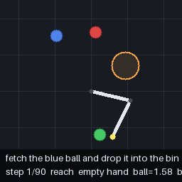
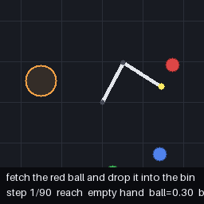
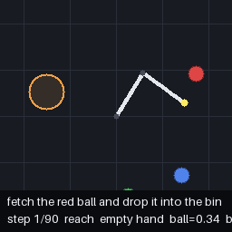

# PocketVLA: GRPO Reward Design and Grasp Failure Analysis

[简体中文](../README.md) | English

A reproduction and experimental extension of [penpenzh/pocketvla](https://github.com/penpenzh/pocketvla), maintained by [os-till-go](https://github.com/os-till-go). The upstream 3.02M VLA, simulator, expert, SFT and GRPO pipeline provide the foundation. This fork studies **why grasping fails and whether an intermediate grasp-window reward improves closed-loop success**.

## Contributions in this fork

- Failure and process analysis on fixed scenarios: approach reversals, window reentries and gripper-command changes. These are descriptive proxies, not evidence of a learned recovery mechanism.
- A configurable, once-per-episode `inwin_bonus` for issuing a close command while empty-handed and within the target-ball grasp window.
- Matched 100-iteration G1/G3 configurations, differing in the reward coefficient (and output directory).
- Archived per-episode outcomes, source-file hashes, exact paired McNemar tests and bootstrap intervals, including results without significant improvements.

Upstream authorship and the [Apache-2.0 license](../LICENSE) are retained. Original architecture descriptions, reference metrics and downloads are available in the [upstream English documentation](UPSTREAM_README_EN.md).

## Recorded results

Existing local reports, archived without retraining. Configuration seed: 42; ID: 500 scenarios; OOD: 300 scenarios with additional distractors.

| Run | Logged GRPO iterations | ID success | ID grasp | OOD success | OOD grasp |
| --- | --- | --- | --- | --- | --- |
| SFT | — | 79.0% | 82.4% | 31.0% | 58.0% |
| GRPO20 / original reward | 20 | 81.0% | 82.6% | 30.7% | 58.7% |
| G1 / original reward | 100 | 78.6% | 81.2% | 32.3% | 60.7% |
| G3 / +0.3 grasp-window bonus | 100 | 78.0% | 81.6% | 34.3% | 60.7% |

**These runs do not establish an improvement from the added reward.** G3 versus G1: ID −0.6 percentage points (`p=0.8199`), OOD +2.0 points (`p=0.4177`, exact McNemar). Single-seed results and incomplete historical provenance limit interpretation; they do not establish that GRPO is ineffective or that reward hacking occurred.

[Experiment report (Chinese)](experiments.md) · [Per-episode data](results/evaluations.json) · [Statistics](results/comparison.md) · [Tools](../tools/README.md)

## Inspect without training

Python 3.10+; no model, dataset or GPU required:

```bash
python tools/compare_results.py
python -m unittest discover -s tests -v
```

See the [reproduction steps](experiments.md#复现步骤) before training. Local checkpoints are not included; upstream downloads are reference assets and may not reproduce the archived local scores.

## Paired examples

These selected ID examples show both directions of change, not aggregate improvement.

| Scenario | G1 | G3 |
| --- | --- | --- |
| #45: failure → success |  |  |
| #249: success → failure |  |  |

The next experiment should first align reward-event timing with the simulator: the current reward checks pre-action distance, whereas grasping uses distance after the joint update. Existing training behavior is preserved in this documentation change.
